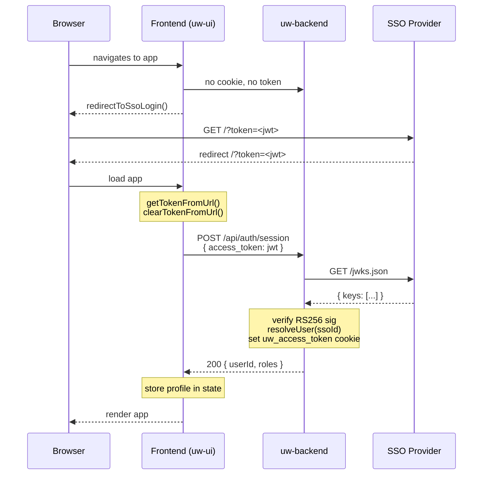
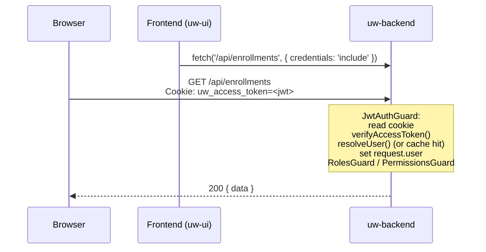
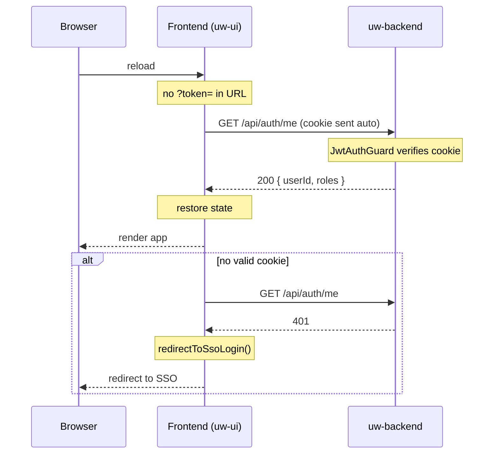
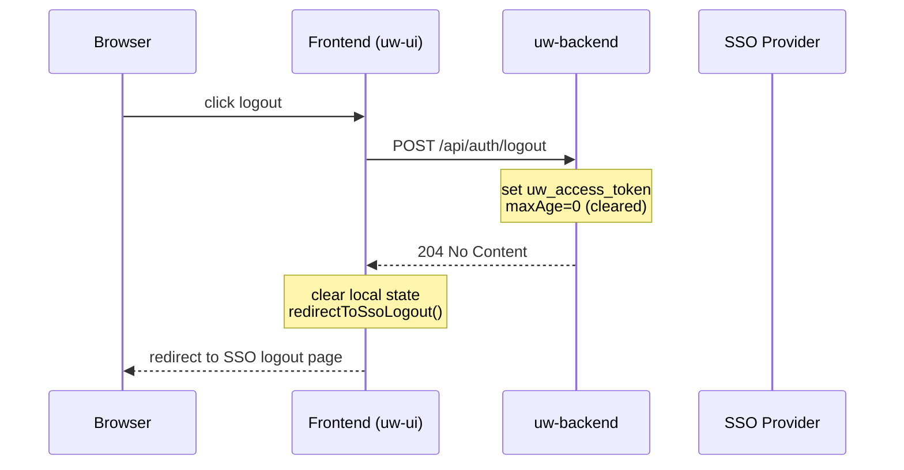

# Authentication

How SSO authentication works in `uw-backend`. Read this before touching any guard, auth service, or session endpoint.

**See also:** [rbac.md](./rbac.md) for roles and permissions.

---

## Table of Contents

1. [Overview](#1-overview)
2. [Flow Diagrams](#2-flow-diagrams)
3. [Environment Variables](#3-environment-variables)
4. [Session Endpoints](#4-session-endpoints)
5. [How JWT Verification Works](#5-how-jwt-verification-works)
6. [JWKS Key Caching](#6-jwks-key-caching)
7. [The JwtAuthGuard](#7-the-jwtauthguard)
8. [User Cache](#8-user-cache)
9. [Opting Out of Auth on a Route](#9-opting-out-of-auth-on-a-route)
10. [Common Pitfalls](#10-common-pitfalls)

---

## 1. Overview

The backend does **not** issue or store passwords. All identity is delegated to an external SSO provider. The provider issues RS256-signed JWTs. This service verifies those tokens using the provider's public keys fetched from its JWKS endpoint.

**Token storage:** Access tokens are stored in an `httpOnly; Secure; SameSite=Strict` cookie named `uw_access_token`. JavaScript on the page cannot read this cookie, which eliminates the XSS token-theft risk that comes with `localStorage`.

**How the cookie gets set:**
1. SSO redirects the browser to the frontend with `?token=<access_token>` in the URL.
2. The frontend reads the token, removes it from the URL, and immediately POSTs it to `POST /auth/session`.
3. This endpoint verifies the token, looks up the user, and sets the `uw_access_token` cookie.
4. Every subsequent API request sends the cookie automatically — no JavaScript token handling needed.

---

## 2. Flow Diagrams

### Login (SSO redirect → session cookie)



### Authenticated Request



### Session Resumption (page reload)



### Logout



---

## 3. Environment Variables

| Variable | Required | Description |
|---|---|---|
| `SSO_JWKS_URI` | Yes | JWKS endpoint URL, e.g. `https://your-sso.example.com/.well-known/jwks.json` |
| `SSO_ISSUER` | No | Expected `iss` claim. Omit to skip issuer validation. |
| `SSO_AUDIENCE` | No | Expected `aud` claim. Omit to skip audience validation. |
| `AUTH_JWKS_URI` | Fallback | Alias for `SSO_JWKS_URI`, checked second. |
| `AUTH_ISSUER` | Fallback | Alias for `SSO_ISSUER`. |
| `AUTH_AUDIENCE` | Fallback | Alias for `SSO_AUDIENCE`. |
| `CORS_ORIGIN` | Yes (prod) | Allowed origin for CORS, e.g. `https://app.example.com`. Required in `NODE_ENV=production`. |
| `NODE_ENV` | No | Set to `production` to enable the `Secure` flag on the cookie and enforce `CORS_ORIGIN`. |

The service throws at startup if `CORS_ORIGIN` is unset in production. It throws `401` on the first request if `SSO_JWKS_URI` is unset.

**Cookie `Secure` flag:** When `NODE_ENV=production`, the `uw_access_token` cookie is set with the `Secure` flag, meaning it will only be sent over HTTPS. In development (`NODE_ENV` not set or `development`), the flag is omitted so the cookie works over `http://localhost`.

---

## 4. Session Endpoints

Both endpoints are `@Public()` — the JWT guard does not block them.

### `POST /auth/session`

Exchanges an SSO access token for a session cookie.

**Request body:**
```json
{ "access_token": "<jwt>" }
```

**What it does:**
1. Calls `authService.verifyAccessToken(access_token)` — full JWKS-based RS256 verification.
2. Parses `payload.sub` as an integer `ssoUserId`. Throws `401` if non-numeric.
3. Calls `authService.resolveUser(ssoUserId)`. Throws `404` if user not found or inactive.
4. Computes cookie TTL from `payload.exp`. Throws `401` if the token has already expired.
5. Sets `uw_access_token` cookie: `httpOnly; SameSite=Strict; Path=/; maxAge=<ttl>`.
6. Returns the safe user profile.

**Response (200):**
```json
{
  "userId": 7,
  "sub": "42",
  "roles": ["admin"],
  "permissions": ["enrollment:approve", "user:read"]
}
```

**Errors:** `401` invalid/expired token, `404` user not in DB or inactive.

---

### `POST /auth/logout`

Clears the session cookie server-side.

**What it does:**
Overwrites `uw_access_token` with `maxAge: 0`, which instructs the browser to delete it immediately.

**Response:** `204 No Content`. This endpoint never returns an error — from the client's perspective, logout always succeeds.

---

### `GET /auth/me`

Returns the current user's profile. Used for session resumption on page load.

**Auth:** Requires a valid `uw_access_token` cookie (goes through `JwtAuthGuard`).

**Response (200):**
```json
{
  "userId": 7,
  "sub": "42",
  "roles": ["admin"],
  "permissions": ["enrollment:approve", "user:read"]
}
```

**Error:** `401` if the cookie is missing, invalid, or expired.

---

## 5. How JWT Verification Works

Implemented in `src/auth/auth.service.ts → verifyAccessToken()`.

1. **Decode header** — `jwt.decode(token, { complete: true })` extracts the `kid` (key ID) from the token header without verifying the signature. This is safe because `kid` is only used to select the public key; the actual signature verification happens in step 3.

2. **Fetch the public key** — `getSigningKey(kid)` looks up the matching public key from the JWKS cache. If the cache is stale or missing the `kid`, it refreshes from `SSO_JWKS_URI`.

3. **Verify the signature** — `jwt.verify(token, publicKey, { algorithms: ['RS256'], issuer, audience })` validates:
   - RS256 signature against the public key
   - `exp` (expiry) claim
   - `iss` (issuer) claim, if `SSO_ISSUER` is configured
   - `aud` (audience) claim, if `SSO_AUDIENCE` is configured

4. **Validate `sub`** — The `sub` claim must be present. It identifies the SSO user.

5. **Return payload** — Returns `AccessTokenPayload` (a `JwtPayload` with a guaranteed `sub: string`).

Errors thrown during verification propagate as-is if they are `UnauthorizedException`. Unknown errors (network failures, malformed keys) are wrapped in a generic `UnauthorizedException('Invalid access token')` to avoid leaking internal detail.

---

## 6. JWKS Key Caching

Public keys are cached in memory in a `Map<kid, pem>` with a 5-minute TTL (`cacheTtlMs = 5 * 60 * 1000`).

```
getSigningKey(kid)
  ├── key in cache AND cache is fresh?  → return cached PEM immediately
  ├── refresh already in progress?      → await the pending promise (no duplicate fetch)
  └── cache stale / key missing?        → call refreshJwks()
          ├── GET {SSO_JWKS_URI}
          ├── parse RSA keys
          ├── keyCache.clear()
          ├── populate keyCache with new PEMs
          └── update lastCacheRefresh timestamp
```

A single `pendingRefresh` promise prevents concurrent cache refreshes under load. All concurrent requests that arrive while a refresh is in progress await the same promise rather than each triggering their own fetch.

---

## 7. The JwtAuthGuard

`src/auth/auth.service.ts` handles token verification; `src/auth/jwt-auth.guard.ts` is the NestJS guard that wires verification into the request pipeline.

**What it does per request:**

1. Checks whether the route/controller is decorated `@Public()`. If yes, returns `true` immediately — no auth required.
2. Reads `request.cookies.uw_access_token`. Throws `401` if the cookie is absent.
3. Calls `authService.verifyAccessToken(token)` to get the JWT payload.
4. Parses `payload.sub` as a number (`ssoUserId`). Throws `401` if the value is not an integer (e.g., a UUID-style sub or a float).
5. Looks up the user via `authService.resolveUser(ssoUserId)` (or returns from the in-memory cache if fresh).
6. Throws `401` if the user doesn't exist or `isActive` is `false`.
7. Sets `request.user` to the merged payload + DB data.

**`request.user` shape after the guard runs:**

```typescript
type AuthenticatedUser = {
  // JWT claims
  sub: string;               // SSO user ID (string form)
  iat?: number;
  exp?: number;
  iss?: string;
  aud?: string | string[];
  // DB-derived fields (from resolveUser)
  userId: number;            // internal DB primary key
  roles: string[];           // e.g. ['admin', 'underwriter']
  permissions: string[];     // e.g. ['user:read', 'enrollment:approve']
};
```

Access `request.user` in handlers via the `@CurrentUser()` decorator — see [rbac.md § Decorators](./rbac.md#3-decorators-reference).

---

## 8. User Cache

To avoid a deep Prisma join (user → roles → permissions) on every request, `authService.resolveUser()` results are cached in `JwtAuthGuard` for **30 seconds**, keyed by `ssoUserId`.

```typescript
private readonly userCache = new Map<number, { data: ResolvedUser; expiresAt: number }>();
private readonly cacheTtlMs = 30_000;
```

Stale entries are evicted on the next access (not via a background timer). When a cache miss occurs, the guard calls `authService.resolveUser()` which does a fresh Prisma query.

**Consequence:** Role and permission changes take up to 30 seconds to take effect for already-authenticated users. If you need immediate revocation, either reduce `cacheTtlMs` or delete the user's cache entry from the service that modifies roles:

```typescript
// inside a service that revokes a role:
this.jwtAuthGuard.userCache.delete(ssoUserId); // not currently exposed — reduce cacheTtlMs instead
```

**Two separate caches exist:**

| Cache | Location | TTL | Key |
|---|---|---|---|
| JWKS public keys | `AuthService.keyCache` | 5 minutes | JWT `kid` |
| User roles/permissions | `JwtAuthGuard.userCache` | 30 seconds | `ssoUserId` |

---

## 9. Opting Out of Auth on a Route

Decorate the handler (or the whole controller) with `@Public()`:

```typescript
import { Public } from '../auth/public.decorator';

@Controller('health')
export class HealthController {
  @Get()
  @Public()
  check() {
    return { status: 'ok' };
  }
}
```

When `@Public()` is present, `JwtAuthGuard` returns `true` without reading the cookie. `RolesGuard` and `PermissionsGuard` still run but pass through immediately because `request.user` will be `undefined`.

**Warning:** Do not add `@Public()` to an entire controller that contains handlers which call `@CurrentUser()`. Those handlers will receive `undefined` as the user and throw a `TypeError` at runtime.

---

## 10. Common Pitfalls

**`uw_access_token` cookie not sent in development**
The frontend Vite dev server proxies `/api/*` to the backend (`localhost:3000`). API calls must use the `/api/` prefix. If you call the backend directly on port 3000 from the browser, the `SameSite=Strict` cookie will not be sent because the origins differ.

**Cookie not set after `POST /auth/session`**
Check that `NODE_ENV` is not set to an unexpected value. In development, `Secure` is omitted so the cookie works over HTTP. Confirm the response includes `Set-Cookie` with `uw_access_token`. Also verify the request includes `credentials: 'include'`.

**`ssoUserId` type**
The `users` table stores `sso_user_id` as a PostgreSQL `INTEGER` (32-bit, max ~2.1 billion). The SSO provider's user IDs must fit within this range. If your provider uses 64-bit IDs, migrate the column to `BIGINT` and update `SafeUser.ssoUserId` and `CreateUserDto.ssoUserId` accordingly.

**Circular module imports**
`AuthModule` imports `PrismaModule`. `UsersModule` imports both `PrismaModule` and `AuthModule`. Do not have `AuthModule` import `UsersModule` — this creates a circular dependency.

**Token expiring too soon**
`POST /auth/session` throws `401 Token has expired` if the token's `exp` claim is already in the past at the time the session is created. This can happen if the SSO redirect takes longer than the token's remaining validity. The user will be redirected back to SSO login automatically.
