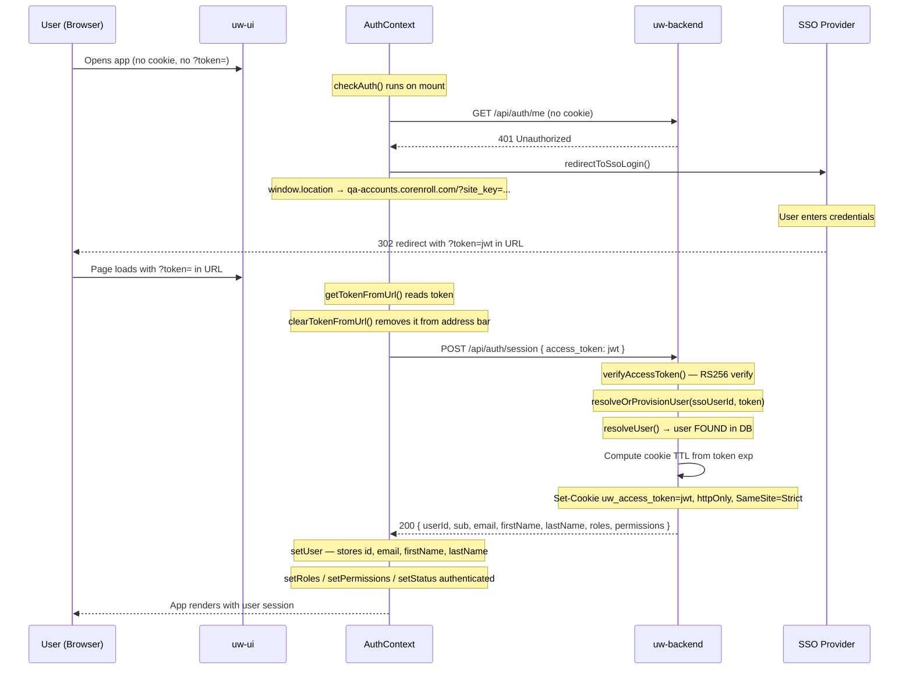
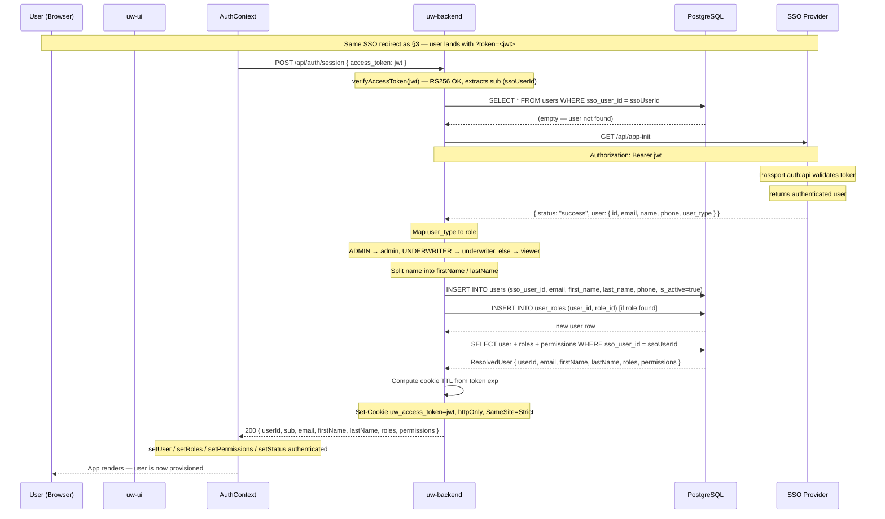
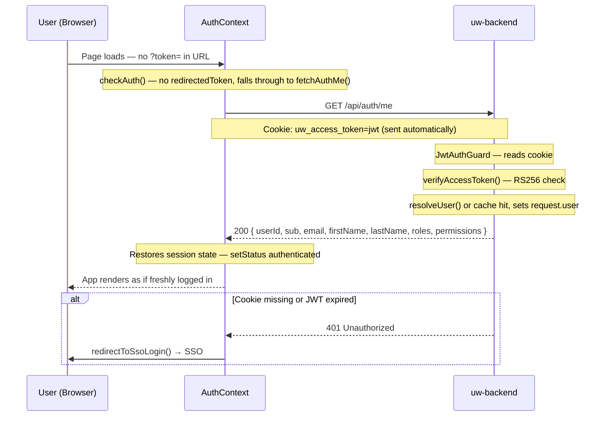
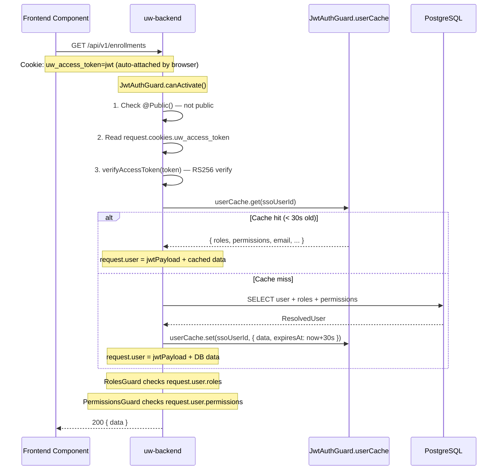
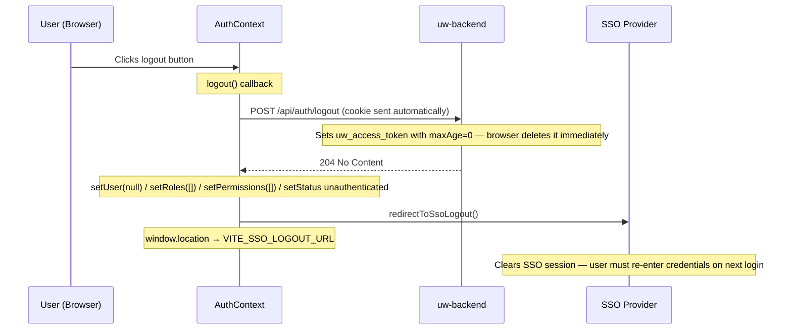

# Full Authentication Flow

End-to-end reference for how the SSO, frontend (`uw-ui`), and backend (`uw-backend`) connect, how a user gets logged in, how tokens are validated on every request, and how API routes are protected.

---

## Table of Contents

1. [System Topology](#1-system-topology)
2. [Environment Wiring](#2-environment-wiring)
3. [First Login — Existing User](#3-first-login--existing-user)
4. [First Login — New User (Auto-Provisioning)](#4-first-login--new-user-auto-provisioning)
5. [Session Resumption (Page Reload)](#5-session-resumption-page-reload)
6. [Per-Request Authentication](#6-per-request-authentication)
7. [Token Storage & Security](#7-token-storage--security)
8. [Token Validation Deep-Dive](#8-token-validation-deep-dive)
9. [API Protection — Guard Chain](#9-api-protection--guard-chain)
10. [Logout](#10-logout)
11. [What Happens When Things Go Wrong](#11-what-happens-when-things-go-wrong)

---

## 1. System Topology

Three independent systems participate in every login:

```
┌─────────────────────────────────────────────────────────────────┐
│  SSO Provider  (ApiSso — Laravel + Passport)                    │
│  qa-sso-api.corenroll.com                                       │
│                                                                 │
│  • Owns user identities and passwords                           │
│  • Issues RS256-signed JWTs (access token + refresh token)      │
│  • Hosts /api/app-init  — returns user profile for a token      │
│  • Hosts /api/.well-known/jwks.json  — public keys for RS256    │
│  • Hosts /api/v2/refresh-token  — issues new token pair         │
│  • Access tokens expire: 15 days (Passport) / 1 week (custom)  │
│  • Refresh tokens expire: 30 days                               │
└────────────────────────┬────────────────────────────────────────┘
                         │  RS256 JWT (in URL on first redirect,
                         │  then as Bearer token in server calls)
                         │
┌────────────────────────▼────────────────────────────────────────┐
│  uw-ui  (React + Vite, port 5173 in dev)                        │
│                                                                 │
│  • Reads ?token= from URL after SSO redirect                    │
│  • Exchanges it for a session cookie via POST /api/auth/session │
│  • Never holds the raw JWT in JS memory after exchange          │
│  • All subsequent /api/* calls use the cookie automatically     │
└────────────────────────┬────────────────────────────────────────┘
                         │  httpOnly cookie: uw_access_token
                         │  (proxied: /api → localhost:3000)
                         │
┌────────────────────────▼────────────────────────────────────────┐
│  uw-backend  (NestJS, port 3000)                                │
│                                                                 │
│  • Verifies JWT signature using SSO's public keys (JWKS)        │
│  • Stores user profile, roles, permissions in PostgreSQL        │
│  • Auto-provisions new users on first login                     │
│  • Protects routes via four global guards                       │
└─────────────────────────────────────────────────────────────────┘
```

**Why a backend session?**
The frontend never exposes the JWT to JavaScript after the initial exchange. It is stored in an `httpOnly` cookie — inaccessible to `document.cookie` or any script — which eliminates the XSS token-theft attack surface that comes with `localStorage`.

---

## 2. Environment Wiring

The three systems are connected by these configuration values:

### uw-ui (`uw-ui/.env`)

| Variable | Value (QA) | Purpose |
|---|---|---|
| `VITE_SSO_LOGIN_URL` | `https://qa-accounts.corenroll.com/?site_key=` | SSO login page — user is sent here when unauthenticated |
| `VITE_SSO_SITE_KEY` | `3NVenhMV...` | Identifies this app to the SSO; appended to the login URL |
| `VITE_SSO_USER_INFO_URL` | `https://qa-sso-api.corenroll.com/api/app-init` | Kept for reference; unused post-session (deprecated `fetchSsoUserInfo`) |
| `VITE_API_BASE_URL_V1` | `/api/v1` | Base path for all backend API calls |

**Vite dev proxy** (`vite.config.ts:17-23`): Any request to `/api/*` from the browser is transparently forwarded to `http://localhost:3000`. This means cookies set by the backend on `localhost:3000` are correctly sent on all `/api/*` calls in development.

### uw-backend (`uw-backend/.env`)

| Variable | Value (QA) | Purpose |
|---|---|---|
| `SSO_JWKS_URI` | `https://qa-sso-api.corenroll.com/api/.well-known/jwks.json` | Fetch SSO's RSA public keys to verify JWT signatures |
| `SSO_APP_INIT_URI` | `https://qa-sso-api.corenroll.com/api/app-init` | Fetch user profile from SSO during auto-provisioning |
| `DATABASE_URL` | `postgresql://...` | PostgreSQL connection (users, roles, permissions) |
| `FRONTEND_URL` | `http://localhost:5173` | Allowed CORS origin |
| `PORT` | `3000` | NestJS listen port |

---

## 3. First Login — Existing User

The user has already been provisioned in the `users` table (either manually or from a previous login).



**Key code locations:**
- `AuthContext.checkAuth()` — `src/context/AuthContext.tsx:51`
- `createSession()` — `src/services/authService.ts:85`
- `AuthController.createSession()` — `src/auth/auth.controller.ts:25`
- `AuthService.resolveOrProvisionUser()` — `src/auth/auth.service.ts:211`

---

## 4. First Login — New User (Auto-Provisioning)

The user has never logged into this app before. Their SSO account exists but there is no row for them in the `users` table.



### What if the SSO app-init call fails?

`fetchSsoUser()` (`src/auth/auth.service.ts:268`) now throws explicitly on failures:

| Failure | HTTP status to client | Log output |
|---|---|---|
| Network unreachable | `500 Internal Server Error` | `[AuthService] fetchSsoUser network error: <message>` |
| SSO returns non-200 | `401 Unauthorized` | `[AuthService] SSO app-init responded <status>: <body>` |
| SSO body missing `user` field | `500 Internal Server Error` | `[AuthService] SSO app-init unexpected response body: <json>` |

The frontend (`AuthContext.tsx:82`) catches `ApiError` with `status >= 500` and shows an error page instead of redirecting to SSO — breaking what would otherwise be an infinite redirect loop.

### Concurrent first-login race condition

If two requests arrive simultaneously for the same new user (e.g. browser tabs), the second `INSERT` hits the `UNIQUE` constraint on `sso_user_id`. The `P2002` error is caught and handled by simply calling `resolveUser()` to return the row that the first request already created. (`auth.service.ts:252-258`)

---

## 5. Session Resumption (Page Reload)

The user refreshes the page. There is no `?token=` in the URL, but the `uw_access_token` cookie exists.



**Key code locations:**
- `fetchAuthMe()` — `src/services/authService.ts:105`
- `AuthController.getProfile()` — `src/auth/auth.controller.ts:83`

---

## 6. Per-Request Authentication

Every API call after login automatically carries the cookie. The browser attaches it because `credentials: 'include'` is set on all fetch calls, and the Vite proxy forwards it to the backend.



---

## 7. Token Storage & Security

### How the token is stored

```
SSO Issues JWT
      │
      │  1. SSO redirects browser to: https://app/?token=<jwt>
      │     (JWT is briefly in the URL — only visible in browser history)
      │
      ▼
Frontend reads token from URL
      │
      │  2. clearTokenFromUrl() removes it from the address bar immediately
      │     via history.replaceState() — no reload, URL is clean
      │
      ▼
POST /auth/session { access_token: jwt }
      │
      │  3. Backend verifies, then sets:
      │     Set-Cookie: uw_access_token=<jwt>;
      │       HttpOnly;       ← JS cannot read this (document.cookie blind)
      │       Secure;         ← HTTPS only (in production)
      │       SameSite=Strict;← not sent on cross-site requests
      │       Path=/;
      │       Max-Age=<ttl>   ← matches token's exp claim
      │
      ▼
Browser cookie jar
      │
      │  4. Browser sends it automatically on every same-site request
      │     Frontend uses: fetch('/api/...', { credentials: 'include' })
      │
      ▼
Never in JS memory after step 2
```

### Security properties

| Property | Mechanism | Protects against |
|---|---|---|
| `HttpOnly` cookie | Browser withholds cookie from `document.cookie` | XSS — a malicious script cannot steal the token |
| `SameSite=Strict` | Cookie not sent on cross-origin requests | CSRF — a malicious page cannot trigger authenticated requests |
| `Secure` flag (production) | Cookie only sent over HTTPS | Token interception on the wire |
| `clearTokenFromUrl()` | Removes token from URL bar immediately | Token leakage via browser history, referer headers, server logs |
| Token never stored in `localStorage` | Only lives in the cookie jar | XSS persistence, browser extension access |
| Cookie TTL = token `exp` | `maxAge` derived from `payload.exp - now` | Stale cookies auto-expire in sync with the JWT |

---

## 8. Token Validation Deep-Dive

Every protected request goes through `AuthService.verifyAccessToken()` (`src/auth/auth.service.ts:88`).

### Step-by-step

```
Incoming JWT
     │
     ▼ jwt.decode(token, { complete: true })
     │  — decode WITHOUT verifying (safe — only reads header)
     │  — extracts: kid (Key ID from JWT header)
     │
     ▼ getSigningKey(kid)
     │  ┌─ key in keyCache AND cache < 5 min old?
     │  │   → return cached PEM immediately
     │  ├─ refresh already in progress?
     │  │   → await the existing promise (no duplicate fetch)
     │  └─ cache stale or kid missing?
     │      → GET https://qa-sso-api.corenroll.com/api/.well-known/jwks.json
     │        parse RSA keys → convert to PEM → store in keyCache
     │        update lastCacheRefresh timestamp
     │
     ▼ jwt.verify(token, publicKey, { algorithms: ['RS256'] })
     │  validates:
     │    ✓ RS256 signature — proves SSO issued this token (private key never leaves SSO)
     │    ✓ exp claim — token has not expired
     │    ✓ iss claim — if SSO_ISSUER is set (currently unset for corenroll)
     │    ✓ aud claim — if SSO_AUDIENCE is set (currently unset)
     │
     ▼ payload.sub present?
     │  sub = SSO's user ID (numeric string, e.g. "42")
     │
     ▼ returns AccessTokenPayload { sub, iat, exp, ... }
```

### JWKS caching

Public keys change rarely (only on SSO key rotation). Fetching on every request would be expensive. The cache prevents this:

```typescript
// auth.service.ts
private readonly keyCache = new Map<string, string>(); // kid → PEM
private readonly cacheTtlMs = 5 * 60 * 1000;          // 5 minutes
private lastCacheRefresh = 0;
private pendingRefresh: Promise<void> | null = null;   // prevents concurrent fetches
```

A single `pendingRefresh` promise ensures that if 100 concurrent requests all find a stale cache simultaneously, only **one** JWKS fetch is made — all others await the same promise.

### User cache

After JWT verification, `resolveUser()` does a Prisma join across five tables to load roles and permissions. This would be a DB hit on every single API call. `JwtAuthGuard` caches the result:

```typescript
// jwt-auth.guard.ts
private readonly userCache = new Map<number, { data: ResolvedUser; expiresAt: number }>();
private readonly cacheTtlMs = 30_000; // 30 seconds
```

Keyed by `ssoUserId`. Stale entries are evicted on the next access. Role or permission changes in the DB take up to **30 seconds** to propagate to active sessions.

---

## 9. API Protection — Guard Chain

All four guards are registered globally in `AppModule` via `APP_GUARD`. They run in this order on every request:

```
Incoming HTTP Request
        │
        ▼
┌───────────────────┐
│  ThrottlerGuard   │  Rate limiting — prevents brute-force
│  (1st)            │  Fail → 429 Too Many Requests
└────────┬──────────┘
         │ pass
         ▼
┌───────────────────────────────────────────────────────┐
│  JwtAuthGuard  (2nd)                                  │
│                                                       │
│  @Public() on route? ────────────────────────────────>│ skip (no request.user)
│                                                       │
│  uw_access_token cookie missing? ──────────────────── 401
│  JWT signature invalid?         ──────────────────── 401
│  JWT expired?                   ──────────────────── 401
│  sub not a valid integer?       ──────────────────── 401
│  user not found in DB?          ──────────────────── 401
│  user.isActive = false?         ──────────────────── 401
│                                                       │
│  ✓ sets request.user = jwtPayload + ResolvedUser      │
└────────┬──────────────────────────────────────────────┘
         │ pass
         ▼
┌───────────────────────────────────────────────────────┐
│  RolesGuard  (3rd)                                    │
│                                                       │
│  No @Roles(...) decorator? ────────────────────────── pass through
│                                                       │
│  Logic: user.roles.some(r => requiredRoles.includes(r))
│         (OR — any one matching role is enough)        │
│                                                       │
│  No match ──────────────────────────────────────────── 403 Forbidden
└────────┬──────────────────────────────────────────────┘
         │ pass
         ▼
┌───────────────────────────────────────────────────────┐
│  PermissionsGuard  (4th)                              │
│                                                       │
│  No @Permissions(...) decorator? ──────────────────── pass through
│                                                       │
│  Logic: requiredPerms.every(p => user.permissions.includes(p))
│         (AND — user must have ALL listed permissions) │
│                                                       │
│  Missing any permission ───────────────────────────── 403 Forbidden
└────────┬──────────────────────────────────────────────┘
         │ pass
         ▼
   Route Handler runs
   @CurrentUser() injects request.user as AuthenticatedUser
```

### Route protection examples

```typescript
// Public — no auth at all
@Public()
@Post('auth/session')

// Authenticated only — any valid logged-in user
@Get('auth/me')

// Role-gated (OR)
@Get()
@Roles('admin', 'underwriter')
listEnrollments()

// Permission-gated (AND — must have ALL)
@Patch(':id/approve')
@Permissions('enrollment:approve')
approve()

// Role AND permission (both must pass)
@Post()
@Roles('admin')
@Permissions('user:create')
createUser()
```

### What `request.user` contains after the guard

```typescript
type AuthenticatedUser = {
  // From the JWT
  sub: string;          // SSO user ID as string, e.g. "42"
  iat?: number;         // issued-at timestamp
  exp?: number;         // expiry timestamp
  iss?: string;         // issuer (if present in token)
  aud?: string | string[];

  // From the DB (via resolveUser)
  userId: number;       // internal PK, e.g. 7
  email: string;        // "alice@example.com"
  firstName: string;    // "Alice"
  lastName: string;     // "Smith"
  roles: string[];      // ["admin", "underwriter"]
  permissions: string[];// ["enrollment:approve", "user:read", ...]
};
```

---

## 10. Logout



The backend logout endpoint (`POST /auth/logout`) is `@Public()` — it does not require a valid JWT. This ensures logout always succeeds even if the token has already expired.

---

## 11. What Happens When Things Go Wrong

### JWT expired mid-session

The cookie's `Max-Age` mirrors the token's `exp`, so both expire together. When the next API call arrives:

1. `JwtAuthGuard` calls `verifyAccessToken()` → `jwt.verify` throws `TokenExpiredError`
2. Guard throws `401 Unauthorized`
3. Frontend's `GET /auth/me` on page load returns 401
4. `AuthContext` calls `redirectToSsoLogin()` — user is sent back to SSO

The SSO may issue a new token silently (if its own session cookie is still valid) or ask for credentials again.

### SSO app-init fails during provisioning

New user first login. `fetchSsoUser()` throws one of:

| Condition | Backend response | Frontend behaviour |
|---|---|---|
| Network error reaching SSO | `500` + log | `AuthContext` shows error page (no redirect loop) |
| SSO returns 401 | `401` + log of response body | `AuthContext` redirects to SSO (token may be invalid) |
| SSO returns unexpected JSON | `500` + log of body | `AuthContext` shows error page (no redirect loop) |

Check backend console logs (`[AuthService] SSO app-init responded ...`) for the exact failure reason.

### User deactivated or role revoked

The `JwtAuthGuard` user cache has a 30-second TTL. Changes in the DB are not immediate:

- `isActive = false` → user is locked out within 30 seconds
- Role/permission change → new access level takes effect within 30 seconds

For immediate revocation, reduce `cacheTtlMs` in `jwt-auth.guard.ts:25` to `0` (disables caching, one DB hit per request) during the incident, then restore it.

### `uw_access_token` cookie not sent in development

The cookie is set on `localhost:3000` (NestJS). The Vite dev server runs on `localhost:5173`. Because `SameSite=Strict` is set, the browser sends the cookie only for same-origin requests. The Vite proxy (`/api → localhost:3000`) makes all API calls appear same-origin to the browser — they are sent to `localhost:5173/api/...` and the proxy forwards them. API calls must use the `/api/` prefix. Calling `localhost:3000` directly from the browser will not include the cookie.
