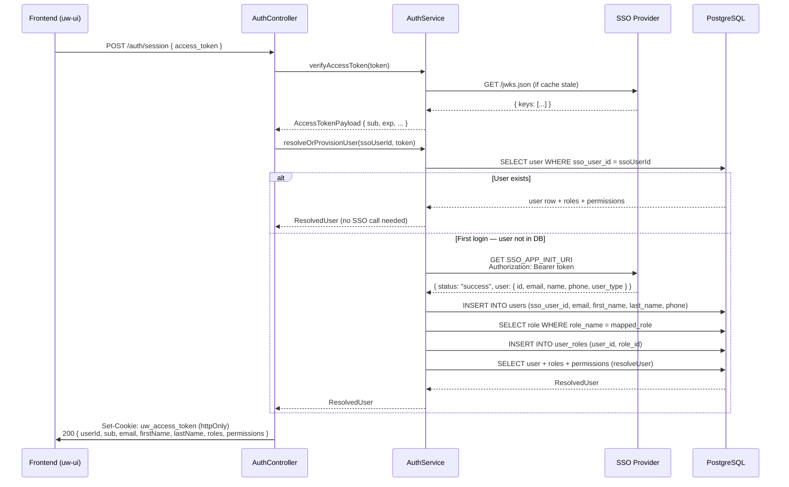
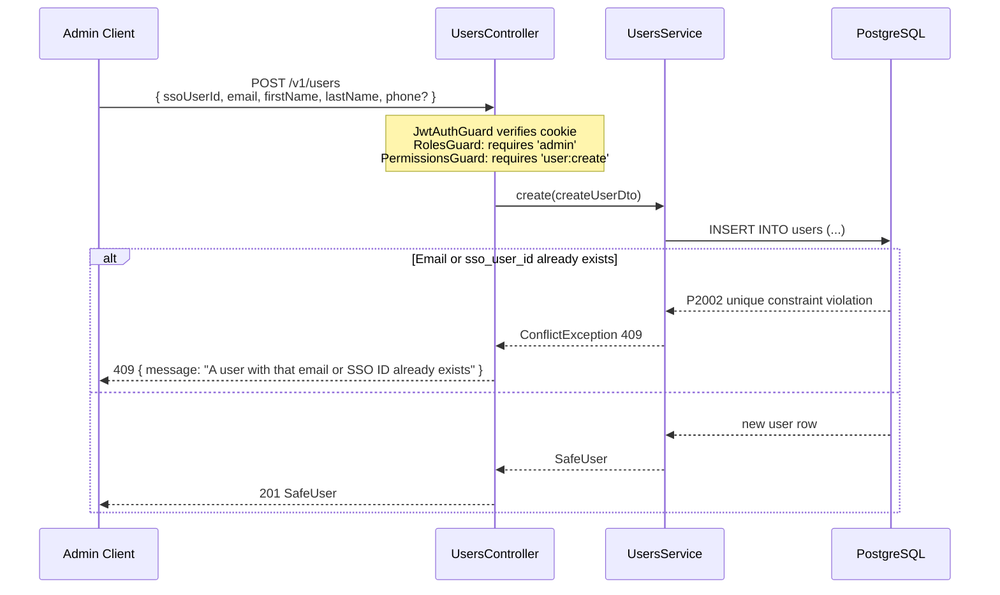
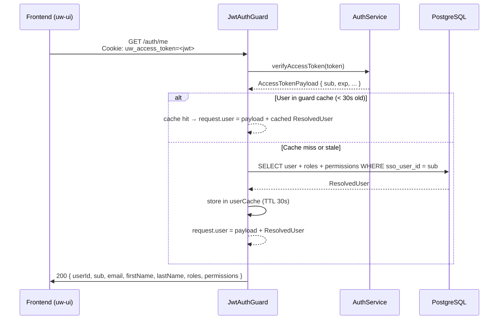
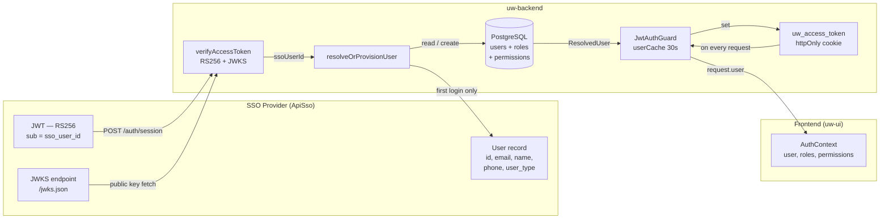

# User Provisioning & Auth Flow

How users get into `uw-backend`'s database, how their roles are assigned, and what happens on every subsequent request. Read this before touching `AuthService.resolveOrProvisionUser`, the `users` table, or any role-assignment logic.

**See also:** [auth.md](./auth.md) for cookie/session mechanics and JWKS verification. [rbac.md](./rbac.md) for guard execution order and decorator reference.

---

## Table of Contents

1. [Two Paths to User Creation](#1-two-paths-to-user-creation)
2. [First Login — Auto-Provisioning Flow](#2-first-login--auto-provisioning-flow)
3. [Manual User Creation (Admin API)](#3-manual-user-creation-admin-api)
4. [Session Resumption Flow](#4-session-resumption-flow)
5. [Per-Request Auth Flow](#5-per-request-auth-flow)
6. [Role & Permission Loading](#6-role--permission-loading)
7. [SSO User Type → Role Mapping](#7-sso-user-type--role-mapping)
8. [Data Flow Summary](#8-data-flow-summary)
9. [Common Pitfalls](#9-common-pitfalls)

---

## 1. Two Paths to User Creation

A user row in the `users` table can be created two ways:

| Path | Trigger | Who does it | Role assigned by |
|---|---|---|---|
| **Auto-provisioning** | First SSO login | `AuthService.resolveOrProvisionUser` | SSO `user_type` → `SSO_ROLE_MAP` |
| **Manual creation** | Admin calls `POST /v1/users` | `UsersController` → `UsersService` | Admin assigns separately via DB or future role endpoint |

Auto-provisioning is the common path. Manual creation is used when an admin needs to pre-register a user or override the default role before that user ever logs in.

---

## 2. First Login — Auto-Provisioning Flow

Triggered by `POST /auth/session` when the SSO redirects back with a `?token=` in the URL.



### Key steps inside `resolveOrProvisionUser`

1. **Try `resolveUser(ssoUserId)` first.** If the user already exists and is active, return immediately — no SSO call.
2. **Call SSO app-init endpoint** (`SSO_APP_INIT_URI`) with the Bearer token to fetch the user's profile: `{ id, email, name, phone, user_type }`.
3. **Map `user_type` to a role** — see [§7](#7-sso-user-type--role-mapping).
4. **Split `name` into `firstName` / `lastName`** — splits on the first space; single-word names get `lastName = '-'`.
5. **Create the user row** in a single Prisma `create` call, embedding the role assignment in the same write via `roles: { create: { roleId } }`.
6. **Call `resolveUser` again** to return the full `ResolvedUser` shape (with permissions loaded from DB joins).

---

## 3. Manual User Creation (Admin API)



**Note:** Manual creation does **not** assign a role. The user will be created with no roles, meaning their first login via SSO will succeed (the session cookie is set) but they will fail any `@Roles(...)` or `@Permissions(...)` guard on protected endpoints. Assign a role via SQL after creation:

```sql
INSERT INTO user_roles (user_id, role_id)
SELECT u.user_id, r.role_id
FROM users u, roles r
WHERE u.sso_user_id = <ssoUserId>
  AND r.role_name = 'underwriter';
```

---

## 4. Session Resumption Flow

When the user reloads the page and no `?token=` is in the URL, the frontend calls `GET /auth/me` to restore state from the existing cookie.



If the cookie is missing, expired, or the user is deactivated in the DB, the guard returns `401` and the frontend redirects to SSO login.

---

## 5. Per-Request Auth Flow

Every protected API call goes through the same four global guards in order:

```mermaid
flowchart TD
    A[Incoming Request] --> B[ThrottlerGuard]
    B -->|rate limit exceeded| C[429 Too Many Requests]
    B --> D[JwtAuthGuard]
    D -->|@Public route| E[Skip — no request.user set]
    D -->|no cookie| F[401 Unauthorized]
    D -->|JWT invalid / expired| F
    D -->|sub not integer| F
    D -->|user inactive or not in DB| F
    D -->|pass| G[request.user set]
    G --> H[RolesGuard]
    H -->|no @Roles decorator| I[Pass through]
    H -->|user lacks required role| J[403 Forbidden]
    H -->|pass| K[PermissionsGuard]
    I --> K
    K -->|no @Permissions decorator| L[Pass through]
    K -->|user lacks required permission| J
    K -->|pass| M[Route Handler]
    L --> M
    E --> M
```

---

## 6. Role & Permission Loading

Roles and permissions are loaded in `resolveUser()` via a single Prisma query with nested joins:

```
users
  └── user_roles  (join table)
       └── roles
            └── role_permissions  (join table)
                 └── permissions  { resource, action, name }
```

The result is flattened before being stored:

```typescript
const roles = dbUser.roles.map(ur => ur.role.roleName);
// e.g. ['admin', 'underwriter']

const permissions = [...new Set(
  dbUser.roles.flatMap(ur =>
    ur.role.permissions.map(rp => rp.permission.name)
  )
)];
// e.g. ['user:read', 'user:create', 'enrollment:approve']
// duplicates from multiple roles are removed by Set
```

**Two caches govern how fresh this data is:**

| Cache | Lives in | TTL | Key | Eviction |
|---|---|---|---|---|
| JWKS public keys | `AuthService.keyCache` | 5 min | JWT `kid` | On next access after expiry |
| Resolved user (roles + permissions) | `JwtAuthGuard.userCache` | 30 s | `ssoUserId` | On next access after expiry |

Role or permission changes in the DB take up to **30 seconds** to take effect for active sessions.

---

## 7. SSO User Type → Role Mapping

When auto-provisioning, `user_type` from the SSO response is mapped to a `uw-backend` role name:

```typescript
// auth.service.ts
const SSO_ROLE_MAP: Record<string, string> = {
  ADMIN:       'admin',
  UNDERWRITER: 'underwriter',
};
const DEFAULT_ROLE = 'viewer';
```

If the SSO `user_type` is not in the map (or the SSO app-init call fails entirely), the user is created without a role assignment. They can log in but cannot access any role-protected endpoint.

To add a new mapping, update `SSO_ROLE_MAP` in `src/auth/auth.service.ts` and ensure the target role exists in the `roles` table.

---

## 8. Data Flow Summary



---

## 9. Common Pitfalls

**Auto-provisioning silently skips role assignment if the SSO app-init call fails**
If `SSO_APP_INIT_URI` is not set or the call returns a non-success status, `fetchSsoUser` returns `null` and `resolveOrProvisionUser` returns `null` — the whole session creation throws `404`. The user never gets created. Verify `SSO_APP_INIT_URI` is configured in the environment.

**Manual user creation leaves the user with no roles**
`POST /v1/users` creates the row but assigns no roles. The user can authenticate (cookie is set) but hits `403` on every protected endpoint. Always follow up with a role assignment SQL statement or a future role-assignment endpoint.

**`resolveOrProvisionUser` passes `userId` to `resolveUser` after creation**
On line 225 of `auth.service.ts`, after a new user is created, the code calls `this.resolveUser(user.userId)`. `resolveUser` expects a `ssoUserId`, not a `userId` — this is a latent bug. The query will find no user because `sso_user_id ≠ user_id`. The auto-provisioning path will succeed for the `prisma.user.create` call but return `null` from the final resolve, causing a `404` on first login for new users. Fix: pass `ssoUserId` instead.

**Name splitting on single-word SSO names**
`resolveOrProvisionUser` splits the SSO `name` field on the first space. Names with no space (e.g. `"Alice"`) get `firstName = 'Alice'`, `lastName = '-'`. If the SSO can emit a proper `first_name`/`last_name` structure, prefer those fields over splitting `name`.

**30-second cache means role revocation is not immediate**
Deactivating a user or revoking a role takes effect within 30 seconds. For immediate revocation, delete the entry from `JwtAuthGuard.userCache` — this is not currently exposed via a method, so the practical option is to reduce `cacheTtlMs` in `jwt-auth.guard.ts` while the incident is active.
